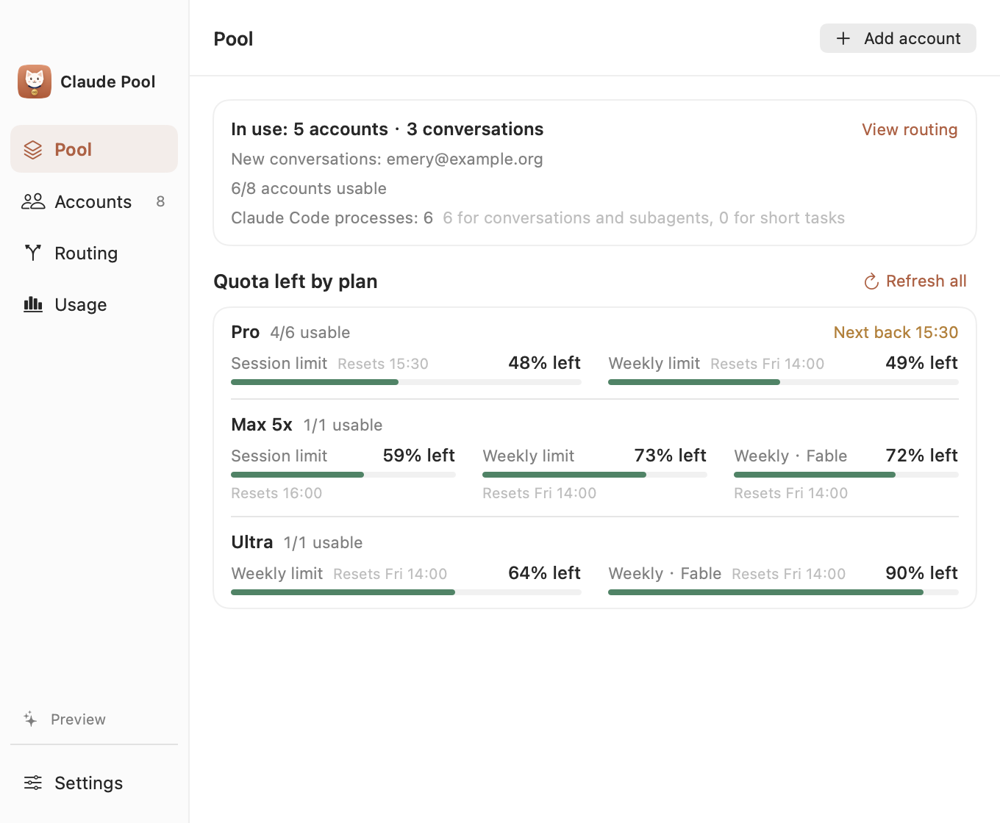
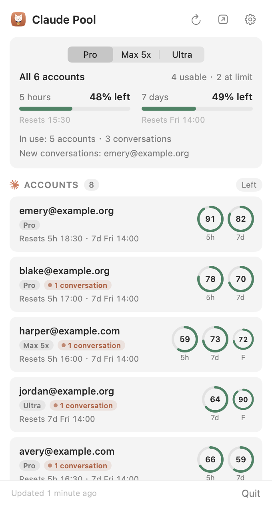
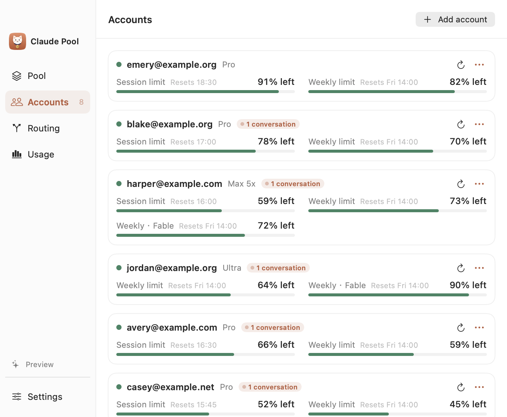
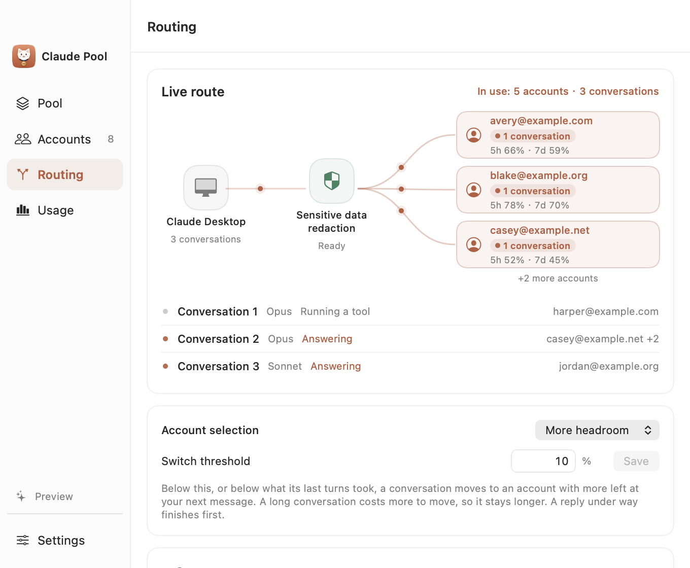
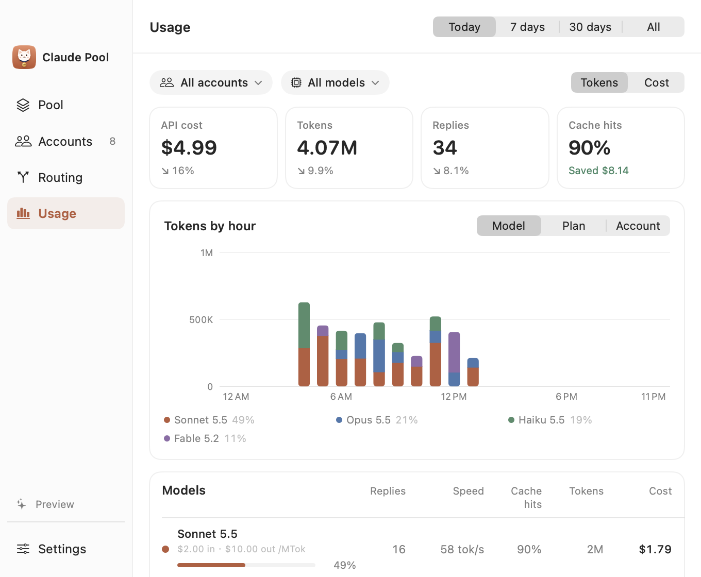
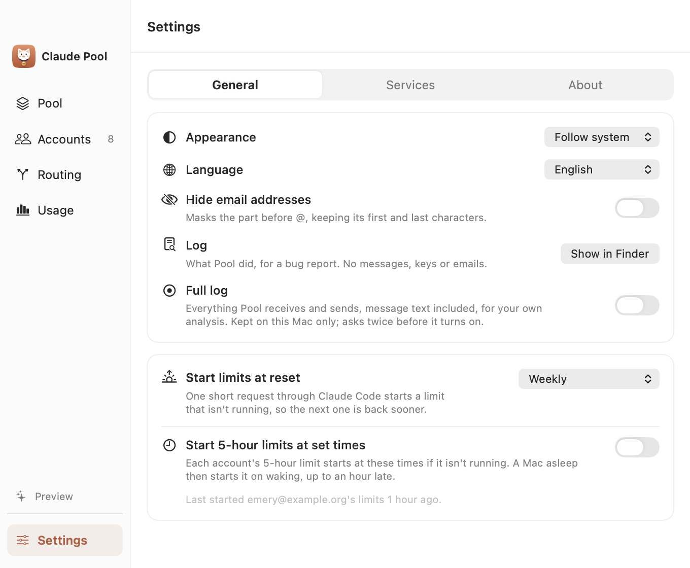

<p align="center">
  
</p>

<p align="center">
  <a href="https://github.com/uiuing/claude-desktop-pool/releases/latest"></a>
  
  <a href="https://github.com/uiuing/claude-desktop-pool/actions/workflows/check.yml"></a>
  <a href="LICENSE"></a>
</p>

<p align="center">
  <b>English</b> · <a href="README.zh-CN.md">简体中文</a>
</p>

<h3 align="center">All your Claude accounts share their quota in one Claude Desktop.</h3>

<p align="center">When one runs low, another takes over, and each conversation keeps its prompt cache. Your private info stays protected.</p>

<table>
  <tr>
    <td width="66%"><picture><source media="(prefers-color-scheme: dark)" srcset="docs/images/pool-en-dark.png"></picture></td>
    <td width="34%"><picture><source media="(prefers-color-scheme: dark)" srcset="docs/images/menu-en-dark.png"></picture></td>
  </tr>
</table>

## Is Claude Pool for you?

You have more than one Claude account, and in Claude Desktop:

- Your conversation stops when an account runs out, and a Pro account runs out within hours.
- Switching accounts means signing out and in, and losing the conversation.
- Subagents and parallel tasks use up one account in minutes while the others sit idle.
- You can't see how much each account has left.
- You worry about keys, passwords or personal info in what you paste.

## What it does

- **Pools the quota of all your accounts.** A conversation goes to the account with the most left and moves on before that one runs out, so it keeps going.
- **Keeps the prompt cache.** Each conversation stays on the account that has it cached and moves only when moving costs less than staying. A long conversation is not written again on account after account.
- **Spreads parallel work.** Subagents and parallel tasks go to different accounts by what each has left and how busy it is.
- **Handles a full pool.** When every account is at its limit, Desktop is told when the first one is back and you get a notification. Claude Code set to wait for a reset goes on by itself.
- **Works everywhere in Desktop.** Chat, Cowork and Code, with the reasoning effort you pick and Claude's thinking shown as it streams.
- **Shows what's left and where work goes.** Every account's quota and reset in the menu bar, including model limits such as Fable's; the Routing page shows which account each conversation is on and why; the Usage page shows tokens, cache hits and estimated cost.
- **Protects your privacy.** Keys, passwords, emails and other private info are hidden on your Mac before anything is sent, and put back in the reply.
- **Looks after itself.** Can start each weekly limit at its reset so the next one comes sooner; keeps Claude Code up to date, never agrees to usage credits, and clears out old files.
- **Connects in one click.** No signing out, no setup; disconnect any time.
- **Uses the official Claude Code** with your own accounts. No API keys.

<table>
  <tr>
    <td width="50%"><picture><source media="(prefers-color-scheme: dark)" srcset="docs/images/accounts-en-dark.png"></picture></td>
    <td width="50%"><picture><source media="(prefers-color-scheme: dark)" srcset="docs/images/routing-en-dark.png"></picture></td>
  </tr>
  <tr>
    <td width="50%"><picture><source media="(prefers-color-scheme: dark)" srcset="docs/images/usage-en-dark.png"></picture></td>
    <td width="50%"><picture><source media="(prefers-color-scheme: dark)" srcset="docs/images/settings-en-dark.png"></picture></td>
  </tr>
</table>

## Install

1. Download the latest `Claude-Pool-*-universal.zip` from [Releases](https://github.com/uiuing/claude-desktop-pool/releases/latest) and move **Claude Pool.app** to Applications.
2. Releases are not notarized yet, so macOS blocks the first launch. Open the app once, then go to **System Settings › Privacy & Security** and click **Open Anyway**. Alternatively run:

   ```bash
   xattr -dr com.apple.quarantine "/Applications/Claude Pool.app"
   ```

Requires macOS 14 or later, on Apple silicon or Intel. Each release lists its SHA-256 checksum beside the download.

## Getting started

1. **Open Claude Pool.** It sets up everything it needs by itself.
2. **Add your accounts.** Sign in with Claude's own login page, as many as you have.
3. **Click Connect.** Claude Desktop starts using those accounts.
4. **Use Desktop as usual.** Pool handles the switching. Click Disconnect any time and everything goes back as it was.

Your normal Claude Desktop sign-in and past conversations are not affected. Conversations made through Pool stay on this Mac and don't show up on the web or your phone.

## How it works

```
Claude Desktop
      │
      ▼
Claude Pool            ← hides your private info
      │                  keeps each conversation on its cached account
      ▼
your Claude accounts   ← the one with the most left, tasks spread across them
```

Claude Desktop hands your question to Pool. Pool hides your private info, keeps the conversation on the account that already has it cached while that account has room, or picks the one with the most left, asks through the official Claude Code, and sends the answer back to Desktop. See [architecture](docs/architecture.md) for the details.

## Build from source

Requires Xcode 26 or later. The app itself runs on macOS 14 and later.

```bash
git clone https://github.com/uiuing/claude-desktop-pool.git
cd claude-desktop-pool
swift build
swift test --parallel
zsh scripts/build.sh
open "dist/Claude Pool.app" --args --demo
```

`--demo` shows synthetic data only: it reads no accounts, starts no gateway and launches no Claude process. `zsh scripts/package.sh --universal` creates the release archive and checksum. See [CONTRIBUTING.md](CONTRIBUTING.md) for the full set of checks.

## Privacy

- **Your accounts stay safe.** Pool never touches your passwords or sign-in details; Claude's own login handles all of that.
- **Private info is hidden.** Keys, passwords, emails and the like are replaced on your Mac before anything is sent, and put back in the reply. Nothing goes through another server.
- **Clean logs.** The log records what Pool did, never what you said.
- **Only this Mac.** Pool only takes requests from Claude Desktop on this Mac.

Privacy protection works on text, not on what's inside images, and it can occasionally miss something. Settings has a preview that shows what it would replace.

## Acknowledgements

Claude Pool is inspired by [Magpie](https://github.com/yetone/magpie). Many thanks to [yetone](https://github.com/yetone) for building and open-sourcing it.

Third-party components and their licenses are listed in [THIRD_PARTY_NOTICES.md](THIRD_PARTY_NOTICES.md).

## Disclaimer

Claude Pool is an independent open-source project, not affiliated with, endorsed by or sponsored by Anthropic. Claude, Claude Code and Claude Desktop are trademarks of Anthropic. Use Pool only with subscriptions you own, and follow Anthropic's terms and usage policies. Anthropic may suspend or ban an account it sees used outside its own apps, and Pool asks you to accept that before the first sign-in. Use an account you can afford to lose. You are responsible for how you use it.

## License

[MIT](LICENSE) © uiuing
