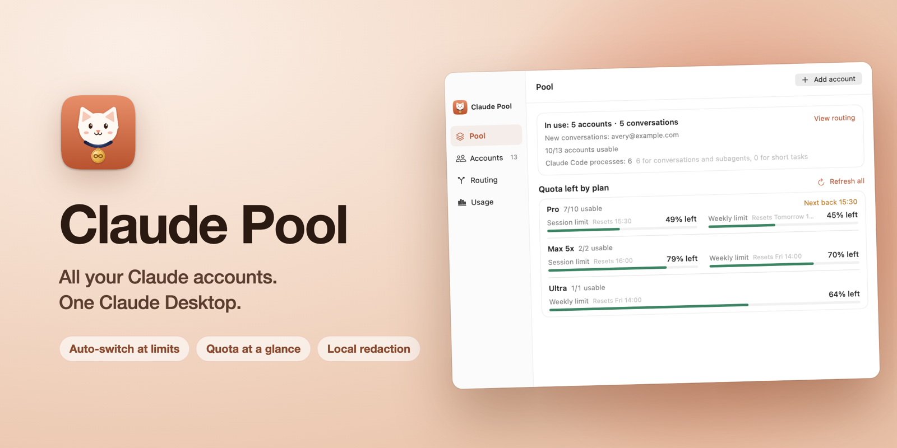

<p align="center">
  
</p>

<p align="center">
  <a href="https://github.com/uiuing/claude-desktop-pool/releases/latest"></a>
  
  <a href="https://github.com/uiuing/claude-desktop-pool/actions/workflows/check.yml"></a>
  <a href="LICENSE"></a>
</p>

<p align="center">
  <b>English</b> · <a href="README.zh-CN.md">简体中文</a>
</p>

<h3 align="center">All your Claude accounts. One Claude Desktop.</h3>

<p align="center">When one account hits its limit, the next one takes over.<br>Same conversation, no signing out, no starting over.</p>

<picture>
  <source media="(prefers-color-scheme: dark)" srcset="docs/images/pool-en-dark.png">
  
</picture>

## Is Claude Pool for you?

You pay for more than one Claude subscription, and using them in Claude Desktop is a chore:

- A long conversation stops when its account reaches the 5-hour or weekly limit.
- Switching means signing out, signing in again and leaving the conversation behind.
- You can't tell which account still has room without checking each one.
- Some accounts run dry while others sit unused, and an unused limit doesn't start its next cycle.
- Pasting code, logs or configs can send keys, passwords and personal data along with your question.

Claude Pool puts all of those accounts behind one connection. Claude Desktop connects once, and Pool decides which account answers.

## Why use Claude Pool

- **Keep talking past a limit.** When an account runs low, the next turn moves to one with room, and the conversation goes with it. A reply that has started is never sent twice.
- **Connect Desktop once.** One click points Claude Desktop at Pool, and adding or removing accounts never touches Desktop again. Disconnect restores your previous settings.
- **See every account's quota at a glance.** The menu bar and dashboard show what is left on each account and exactly when it resets.
- **Use every limit you pay for.** New conversations go to the account with the most room, and Pool can start a limit the moment it resets, so the next reset comes sooner.
- **Keep secrets on your Mac.** Keys, passwords, emails and other personal data in your messages and tool results are masked locally before a request leaves, and put back in the reply. Detection runs on the [AstrLink Guard](https://huggingface.co/QuantumNous/astrlink-guard) model on your Mac; nothing goes to a remote redaction service.
- **Know where your usage goes.** Tokens, cache hits and estimated cost by model, plan and account.
- **Stay on the official client.** Every request runs through the official Claude Code with each account's own sign-in. No API keys, no copied tokens.
- **Nothing to maintain.** Pool installs and updates Claude Code by itself and handles its first-run setup.

<table>
  <tr>
    <td width="50%"><picture><source media="(prefers-color-scheme: dark)" srcset="docs/images/accounts-en-dark.png"></picture></td>
    <td width="50%"><picture><source media="(prefers-color-scheme: dark)" srcset="docs/images/routing-en-dark.png"></picture></td>
  </tr>
  <tr>
    <td width="50%"><picture><source media="(prefers-color-scheme: dark)" srcset="docs/images/usage-en-dark.png"></picture></td>
    <td width="50%"><picture><source media="(prefers-color-scheme: dark)" srcset="docs/images/settings-en-dark.png"></picture></td>
  </tr>
</table>

## Install

1. Download the latest `Claude-Pool-*-universal.zip` from [Releases](https://github.com/uiuing/claude-desktop-pool/releases/latest) and move **Claude Pool.app** to Applications.
2. Releases are not notarized yet, so macOS blocks the first launch. Open the app once, then go to **System Settings › Privacy & Security** and click **Open Anyway**. Alternatively run:

   ```bash
   xattr -dr com.apple.quarantine "/Applications/Claude Pool.app"
   ```

Requires macOS 14 or later, on Apple silicon or Intel. Each release lists its SHA-256 checksum beside the download.

## Getting started

1. **Open Claude Pool.** It installs the official Claude Code client and the local redaction model by itself.
2. **Add accounts.** Each one signs in through Claude's own login; its verified email identifies it.
3. **Connect Claude Desktop.** Pool writes its gateway profile into Desktop's settings and opens Desktop, or asks before restarting it.
4. **Keep using Desktop.** Pool routes conversations behind the connection. Disconnect at any time to restore Desktop's previous settings.

Your normal Desktop sign-in, existing conversations and any Claude Code you installed yourself stay separate and untouched.

## How it works

```
Claude Desktop ──► local gateway (loopback, authenticated)
                       │  local redaction
                       ▼
                  account router ──► official Claude Code (interactive)
                                       one isolated folder per account
```

Desktop sends its requests to Pool's local gateway. Pool redacts sensitive text, chooses an account, and hands the turn to an interactive Claude Code session for that account. Replies stream back as Claude Code receives them, and Desktop's tools are returned to Desktop through an MCP bridge so Desktop still runs them. See [architecture](docs/architecture.md), [compatibility](docs/compatibility.md) and the [product contract](docs/product.md) for details.

## Build from source

Requires Xcode command line tools with a Swift 6 toolchain.

```bash
git clone https://github.com/uiuing/claude-desktop-pool.git
cd claude-desktop-pool
swift build
swift test
zsh scripts/build.sh
open "dist/Claude Pool.app" --args --demo
```

`--demo` shows synthetic data only: it reads no accounts, starts no gateway and launches no Claude process. `zsh scripts/package.sh --universal` creates the release archive and checksum. See [CONTRIBUTING.md](CONTRIBUTING.md) for the full set of checks.

## Privacy

- Pool never reads, copies or logs your Claude credentials; Claude Code keeps them in its own account folders.
- The app log records decisions, counts and timings, not conversation text.
- Redaction runs entirely on your Mac. It works on text and typed tool data; image pixels are not inspected, and like any detector it can miss or misclassify a value. Settings includes a local preview.
- The gateway listens on loopback only, requires a key and rejects browser origins.

## Acknowledgements

Claude Pool is inspired by [Magpie](https://github.com/yetone/magpie). Many thanks to [yetone](https://github.com/yetone) for building and open-sourcing it.

Third-party components and their licenses are listed in [THIRD_PARTY_NOTICES.md](THIRD_PARTY_NOTICES.md).

## Disclaimer

Claude Pool is an independent open-source project, not affiliated with, endorsed by or sponsored by Anthropic. Claude, Claude Code and Claude Desktop are trademarks of Anthropic. Use Pool only with subscriptions you own, and follow Anthropic's terms and usage policies. You are responsible for how you use it.

## License

[MIT](LICENSE) © uiuing
