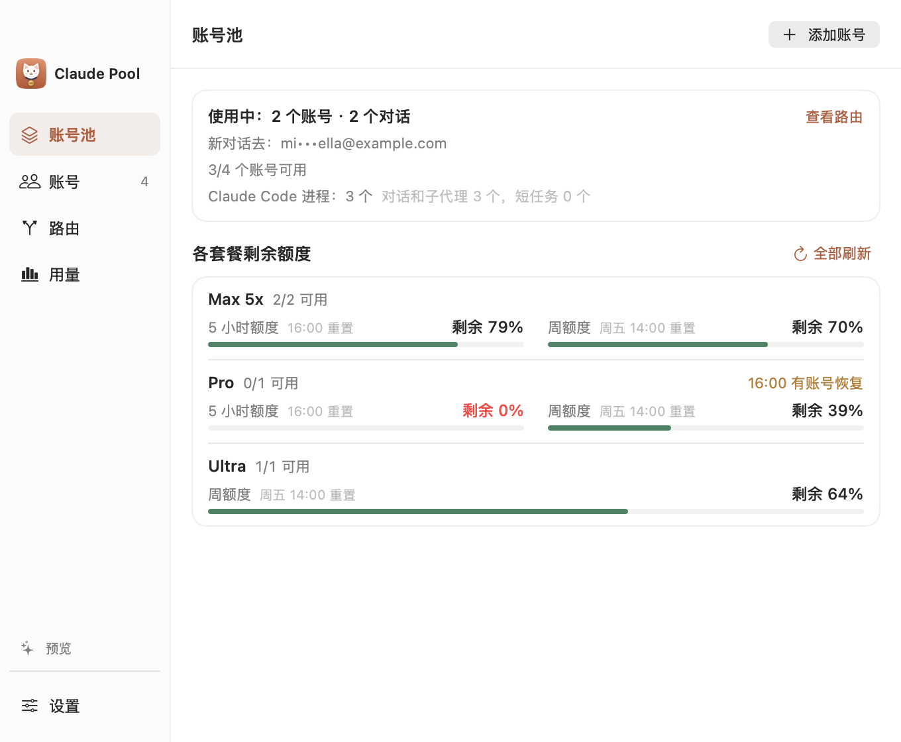
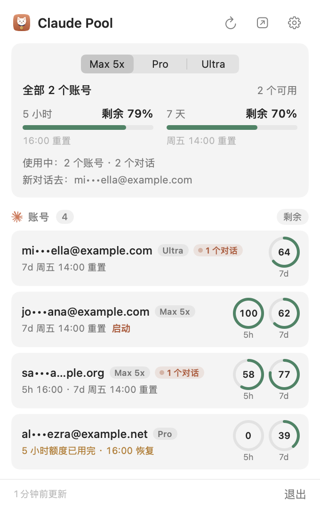
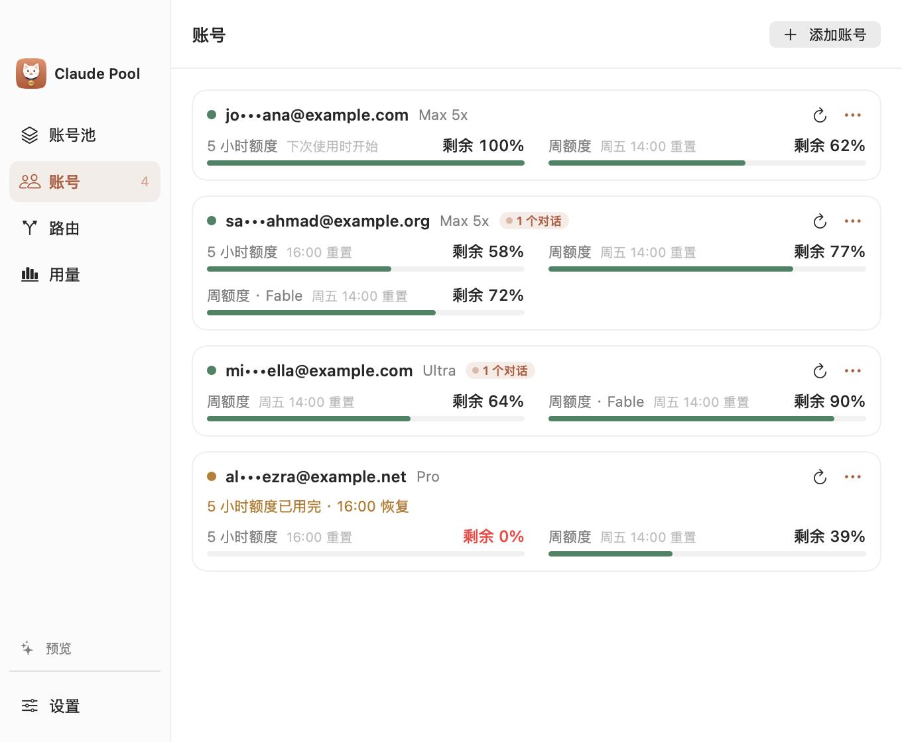
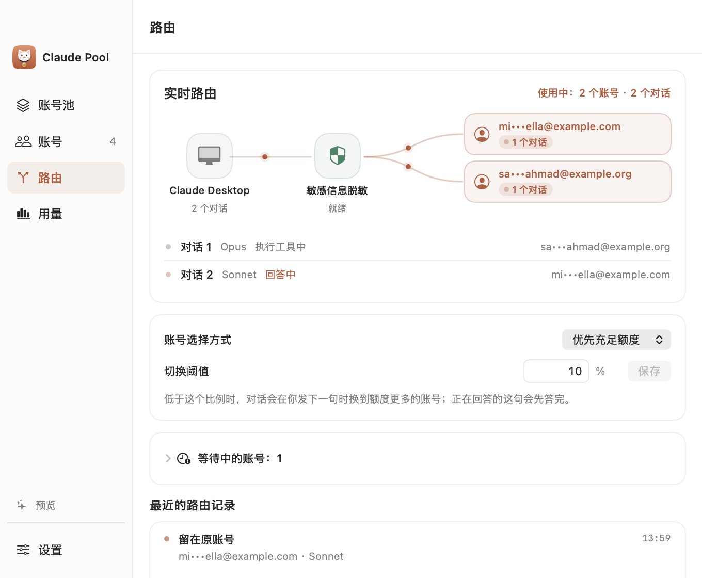
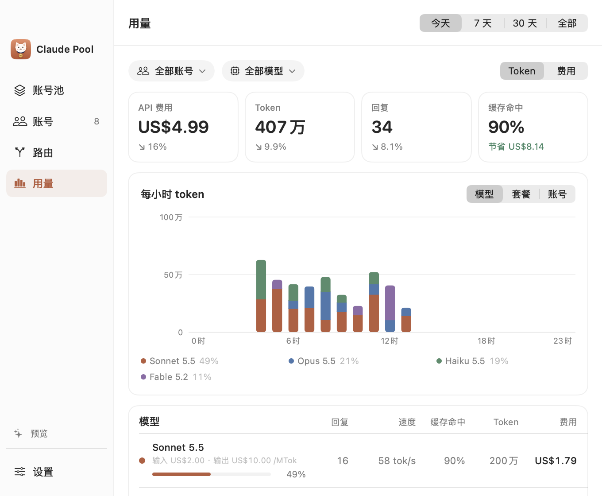
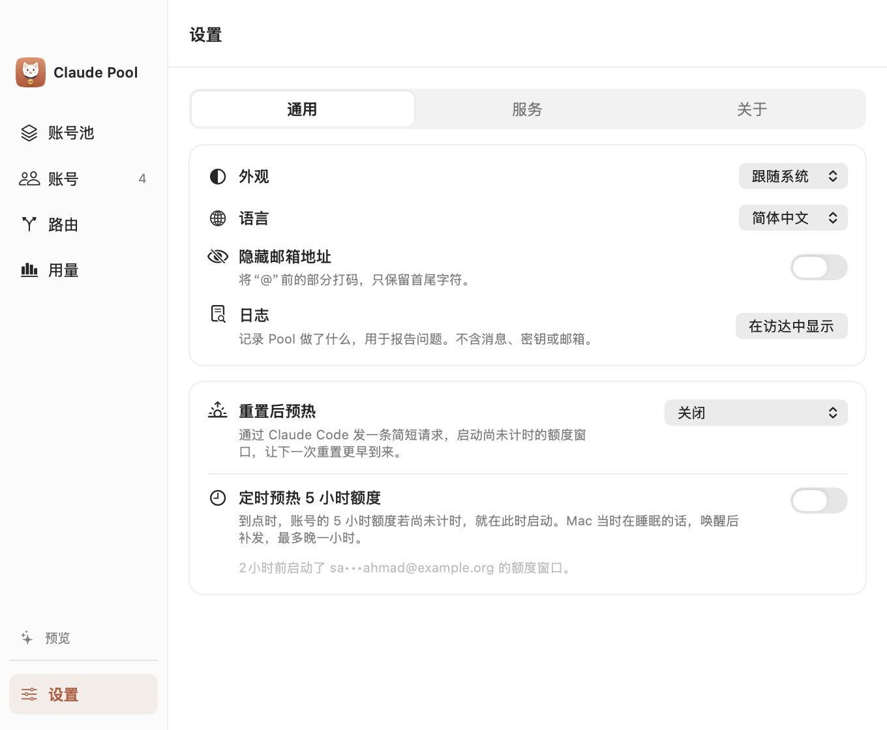

<p align="center">
  
</p>

<p align="center">
  <a href="https://github.com/uiuing/claude-desktop-pool/releases/latest"></a>
  
  <a href="https://github.com/uiuing/claude-desktop-pool/actions/workflows/check.yml"></a>
  <a href="LICENSE"></a>
</p>

<p align="center">
  <a href="README.md">English</a> · <b>简体中文</b>
</p>

<h3 align="center">多个 Claude 账号，在一个 Claude Desktop 里共享额度。</h3>

<p align="center">一个用完了，另一个接上。你的隐私信息也会被保护好。</p>

<table>
  <tr>
    <td width="66%"><picture><source media="(prefers-color-scheme: dark)" srcset="docs/images/pool-zh-Hans-dark.png"></picture></td>
    <td width="34%"><picture><source media="(prefers-color-scheme: dark)" srcset="docs/images/menu-zh-Hans-dark.png"></picture></td>
  </tr>
</table>

## Claude Pool 适合你吗？

你有不止一个 Claude 账号，在 Claude Desktop 里常遇到：

- 账号额度用完，对话就停了。
- 换账号要退出重登，对话也接不上。
- 看不到每个账号还剩多少。
- 担心贴进去的密钥、密码或个人信息被发出去。

## 它能做什么

- **所有账号共享额度。** 一个用完了，另一个接上，对话照常继续。
- **Desktop 里都能用。** Chat、Cowork、Code 都走它。
- **保护你的隐私。** 密钥、密码、邮箱等隐私信息，发出前就在你的 Mac 上藏好，回复里再还原。
- **剩多少一眼看清。** 菜单栏显示每个账号的剩余额度和重置时间。
- **一键连接。** 不用退出登录，不用配置，随时可以断开。
- **用官方 Claude Code** 和你自己的账号，不用 API Key。

<table>
  <tr>
    <td width="50%"><picture><source media="(prefers-color-scheme: dark)" srcset="docs/images/accounts-zh-Hans-dark.png"></picture></td>
    <td width="50%"><picture><source media="(prefers-color-scheme: dark)" srcset="docs/images/routing-zh-Hans-dark.png"></picture></td>
  </tr>
  <tr>
    <td width="50%"><picture><source media="(prefers-color-scheme: dark)" srcset="docs/images/usage-zh-Hans-dark.png"></picture></td>
    <td width="50%"><picture><source media="(prefers-color-scheme: dark)" srcset="docs/images/settings-zh-Hans-dark.png"></picture></td>
  </tr>
</table>

## 安装

1. 从 [Releases](https://github.com/uiuing/claude-desktop-pool/releases/latest) 下载最新的 `Claude-Pool-*-universal.zip`，把 **Claude Pool.app** 拖进「应用程序」。
2. 目前的版本还没有经过 Apple 公证，第一次打开会被 macOS 拦下。先打开一次，再到 **系统设置 › 隐私与安全性** 点 **仍要打开**。也可以在终端执行：

   ```bash
   xattr -dr com.apple.quarantine "/Applications/Claude Pool.app"
   ```

需要 macOS 14 或更高版本，支持 Apple 芯片和 Intel。每个版本的下载文件旁都附有 SHA-256 校验值。

## 开始使用

1. **打开 Claude Pool。** 需要的东西它会自己装好。
2. **添加账号。** 用 Claude 官方的登录页面登录，有几个加几个。
3. **点「连接」。** Claude Desktop 就会开始用这些账号。
4. **照常用 Desktop。** 换账号的事交给 Pool，想停用随时点「断开」，一切恢复原样。

你平时的 Claude Desktop 登录和以前的对话都不受影响。通过 Pool 聊的对话只保存在这台 Mac 上，不会出现在网页端或手机上。

## 工作原理

```
Claude Desktop
      │
      ▼
Claude Pool         ← 先藏好隐私信息
      │
      ▼
你的 Claude 账号    ← 哪个有额度用哪个
```

Claude Desktop 把问题交给 Pool。Pool 先把隐私信息藏好，再挑一个还有额度的账号，用官方 Claude Code 去问，答案原路送回 Desktop。想了解细节可以看 [架构](docs/architecture.md)（英文）。

## 从源码构建

需要 Xcode 26 或更高版本。App 本身支持 macOS 14 及以上。

```bash
git clone https://github.com/uiuing/claude-desktop-pool.git
cd claude-desktop-pool
swift build
swift test
zsh scripts/build.sh
open "dist/Claude Pool.app" --args --demo
```

`--demo` 只显示虚构数据：不读取账号、不启动网关，也不启动任何 Claude 进程。`zsh scripts/package.sh --universal` 会生成发布用的压缩包和校验值。完整检查步骤见 [CONTRIBUTING.md](CONTRIBUTING.md)。

## 隐私

- **账号安全：** Pool 不碰你的密码和登录凭据，登录全部交给 Claude 官方。
- **隐私信息：** 密钥、密码、邮箱这类内容，发出去之前就在你的 Mac 上替换掉，回复里再换回来，全程不经过别的服务器。
- **日志干净：** 日志只记录 Pool 做了什么，不记录你聊了什么。
- **只在本机：** Pool 只接受这台 Mac 上 Claude Desktop 的请求。

隐私保护只处理文字，不识别图片里的内容，偶尔也可能漏掉。设置里可以预览它会替换哪些内容。

## 致谢

Claude Pool 的灵感来自 [Magpie](https://github.com/yetone/magpie)，感谢作者 [yetone](https://github.com/yetone) 开发并开源了这个项目。

第三方组件及其许可证见 [THIRD_PARTY_NOTICES.md](THIRD_PARTY_NOTICES.md)。

## 声明

Claude Pool 是独立的开源项目，与 Anthropic 没有关联，也未获其认可或赞助。Claude、Claude Code 和 Claude Desktop 是 Anthropic 的商标。请只用于你自己拥有的订阅，并遵守 Anthropic 的服务条款和使用政策，使用责任由你自行承担。

## 许可证

[MIT](LICENSE) © uiuing
